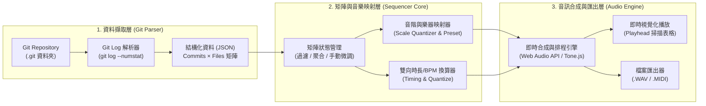

# 🎵 GitMusic 工具規格書與技術概論
> **將專案的開發歷史（Git Commits），譜寫成獨一無二的遊戲背景音樂（BGM）**

---

## 一、 市場調查與核心賣點分析（為什麼「拿來當遊戲音樂」超有潛力？）

### 1. 現有工具盤點與痛點
目前市面上將 Git 轉為聲音（Data Sonification）的開源小工具（例如命令列工具 `git2midi` 或網頁版 `GitSymphony`）主要有以下限制：
* **只像「資料監聽」，不像「音樂」**：多數工具僅將 Commit 時間差與增刪行數直接映射為隨機頻率，聽起來像雜亂的摩斯密碼或現代實驗噪音，無法長時間聆聽。
* **黑盒子轉換、不可視也不可控**：使用者無法直覺看到「哪個檔案在哪個 Commit 發出什麼聲音」，更無法像編曲軟體一樣針對特定檔案調整樂器或節拍。

### 2. 🎯 核心賣點（USP）：「用寫遊戲的過程，自動生成這款遊戲的 BGM」
將你的「檔案 $\times$ Commit 矩陣表格」定位為**遊戲開發者的專屬配樂產生器**，具備極強的話題性與實用價值：

1. **極致的 Meta 敘事與彩蛋行銷（Devlog 流量密碼）**
   * **故事性**：想像在 Steam 商店頁面、群眾募資頁面或開發者日誌（Devlog）中宣稱：*「這款遊戲的標題畫面與製作人員名單（Credits）音樂，是由我們團隊過去 500 次 Git Commit 親自『敲』出來的！」*
   * **角色與程式碼共鳴**：當玩家在遊戲中聽到主旋律響起，那其實是開發者在修改 `PlayerController.cs`；當聽到密集的鼓點，那是團隊在狂修 `BossAI.cs`。這種跨越第四面牆的浪漫，非常受獨立遊戲玩家喜愛。
2. **「表格即編曲機（Step Sequencer）」的直覺可控性**
   * 你設計的 `內容 / commit_1 / commit_2` 矩陣（`o` 與 `_`），本質上就是專業音樂軟體的**步進音序器**。開發者不需要懂樂理，只要把核心腳本設為主旋律、把設定檔設為鼓組，就能視覺化看著節奏成形，甚至能手動點格子微調拍點。
3. **Game Jam 與獨立開發者的救星（100% 獨一無二、零版權爭議）**
   * 在 48 小時的 Game Jam（如 Global Game Jam、Ludum Dare）最後關頭，團隊往往沒時間做音樂。只要把剛寫完的專案 Git 餵進這個工具，30 秒就能匯出一首專屬於這個專案、符合復古 8-bit 或 Synthwave 風格的無縫循環 BGM（`.wav` / `.ogg`），且完全沒有素材撞歌或 AI 版權爭議。
4. **隨遊戲改版「有機演化」的動態配樂**
   * 遊戲從 `v0.1` 更新到 `v1.0`，Commit 變多了，音樂也隨之進化；甚至可以把不同的 Git Branch（例如 `feature/ice-world` 分支）單獨拉出來生成該關卡的專屬變奏曲（Variation）！

---

## 二、 功能規格書 (Functional Specification)

### 1. Git 歷史讀取與過濾模組 (Git Parser & Filter)
* **資料來源**：支援選擇本地端 Git 專案資料夾（透過本地端讀取 `git log`），或輸入公開 GitHub Repo 網址。
* **範圍篩選（針對遊戲專案優化）**：
  * **分支與區間**：可選擇特定 Branch，或指定起訖 Commit / Tag（例如只取 `v1.0` 到 `v1.1` 之間的提交）。
  * **智慧降噪與聚合**：遊戲專案常有大量 `.meta`（Unity）或圖檔。支援**「依資料夾合併」**（如整個 `Scripts/Enemy/` 視為一軌）、**「依副檔名合併」**（如所有 `.cs` 視為一軌）或**「僅顯示變更次數前 $N$ 名的核心檔案」**，避免表格出現上千列。

### 2. 矩陣音序器表格視圖 (Commit Matrix Grid UI)
表格結構完全依照你的構想設計，並強化音樂屬性：

| 檔案 / 軌道名稱 | 指派樂器 | 音高 / 音階 | `c1 (a1b2)` | `c2 (c3d4)` | `c3 (e5f6)` | `c4 (g7h8)` |
| :--- | :--- | :--- | :---: | :---: | :---: | :---: |
| 📄 `Player.cs` | 🎹 8-Bit Lead (主旋律) | `C4` (自動/手動) | **`o`** *(+45)* | `_` | **`o`** *(+12)* | `_` |
| 📄 `GameManager.cs` | 🎸 Synth Bass (貝斯) | `G2` (自動/手動) | **`o`** *(+80)* | `_` | `_` | **`o`** *(+20)* |
| 📄 `LevelData.json` | 🥁 Kick (大鼓) | 固定鼓組 | **`o`** | **`o`** | `_` | **`o`** |
| 📄 `README.md` | 🥁 Hi-Hat (閉合鈸) | 固定鼓組 | `_` | **`o`** | **`o`** | **`o`** |

* **格子狀態 (`o` / `_`) 與視覺回饋**：
  * **`o` (有提交修改)**：觸發該列樂器發聲。可依變更類型染色（🟢 新增 `A`、🔵 修改 `M`、🔴 刪除 `D`），並依修改行數深淺代表**敲擊力度（Velocity / 音量）**。
  * **`_` (無修改)**：休止符（不發聲）。
  * **二次創作模式（Override）**：允許使用者直接在表格上點擊，手動把 `_` 點成 `o` 或把 `o` 關掉，讓開發者可以「修整」出最順耳的遊戲 Loop。

### 3. 樂器指派與「防走音」音階系統 (Instrument & Harmony Engine)
為了確保產出的音樂能直接放進遊戲當 BGM，必須有音樂理論保護機制：
* **遊戲風格主題音色庫（Theme Presets）**：
  * 👾 **8-Bit Chiptune（復古像素風）**：方波（Square）、三角波（Triangle）、雜訊鼓（Noise Drum）。
  * 🌆 **Synthwave / Cyberpunk（電子合成器風）**：Arp 合成器、厚重 Analog Bass、電子鼓。
  * ☕ **Lo-Fi / 溫馨獨立遊戲風**：電鋼琴（Rhodes）、木貝斯、柔和刷鼓。
* **五聲音階防走音鎖定（Scale Lock）**：
  * 若專案有 20 個 `.cs` 檔案都設為旋律樂器，系統會自動根據檔名雜湊（Hash）或資料夾順序，將它們的音高分配在指定的**和諧音階**上（例如：**C 大調五聲音階 `C, D, E, G, A`** 或 **A 小調五聲音階 `A, C, D, E, G`**）。
  * 五聲音階沒有半音衝突，這意味著**不管同一個 Commit 同時改了哪幾個檔案，合在一起彈出來永遠是好聽的和弦！**

### 4. 雙模式時長與節拍控制器 (Dual-Mode Timing Controller)
結合我們討論的雙向換算機制：
* **模式 A：依節奏設定（BPM 優先）**
  * 設定 **BPM**（如 `120 BPM`）與 **每 Commit 代表拍數**（`1/4 拍`、`1/2 拍`、`1 拍`）。
  * 自動計算並即時顯示：`預計總時長 = Commit 數 × 單拍秒數`。
* **模式 B：依目標總時長設定（Duration 優先）**
  * 設定希望這首 BGM 長度為幾秒（例如 `30 秒` 適合短循環、`90 秒` 適合完整關卡曲）。
  * 系統自動反推對應的 BPM；若 Commit 數量過多（例如 1,000 個 Commit 塞進 30 秒），自動啟用**「時間窗取樣 / 每 $N$ 個 Commit 合併為一拍」**，確保節奏清晰不糊掉。

### 5. 遊戲開發專用匯出模組 (Game-Ready Exporter)
* **匯出音訊檔 (`.wav` / `.ogg`)**：支援勾選「尾音無縫循環（Seamless Loop）」，匯出後可直接拖進 Unity / Godot / Unreal 當作 `AudioClip` 使用。
* **匯出標準 MIDI 檔 (`.mid`)**：將每個檔案存成獨立 MIDI Track，方便丟進 FL Studio、Ableton Live 或 Logic Pro 替換成管弦樂或高品質音源。
* **匯出矩陣設定檔 (`.json`)**：儲存目前的樂器指派與手動微調結果。

---

## 三、 技術概論與系統架構 (Technical Overview)

### 1. 系統架構流程圖



### 2. 核心技術原理

#### (1) Git 歷史高效提取指令
透過在背景執行單次 Git 指令，即可在幾毫秒內拿到所有 Commit 與檔案異動行數，無需逐一 Checkout：
```bash
git log --reverse --pretty=format:"COMMIT:%h|%an|%at|%s" --numstat
```
* `--reverse`：讓時間從 `commit_1`（最早）排到最新，符合音樂從頭播到尾的順序。
* `--numstat`：直接輸出每個 Commit 修改了哪些檔案，以及每個檔案的 `+新增行數` 與 `-刪除行數`。

#### (2) 雙向時長與 BPM 換算公式
設總 Commit 數（或合併後的總步數 Steps）為 $N$，每個 Commit 佔用的拍數為 $B$（例如十六分音符為 $0.25$ 拍，四分音符為 $1$ 拍），速度為 $\text{BPM}$（每分鐘拍數），總時長為 $T$（秒）：

$$T = N \times B \times \left(\frac{60}{\text{BPM}}\right) \quad \Longleftrightarrow \quad \text{BPM} = \frac{60 \times N \times B}{T}$$

* **防機關槍保護機制（Auto-Downsampling）**：當使用者設定固定時長 $T$ 導致計算出的 $\text{BPM} > 240$（每步小於 $0.06$ 秒）時，系統自動將合併係數 $K = \lceil \text{BPM} / 160 \rceil$ 套用至矩陣，將每 $K$ 個連續 Commit 的 `o` 進行邏輯或（`OR`）合併為 1 拍，維持最佳聽感。

#### (3) 檔案轉音高與力度的演算法
* **音高映射（Pitch Mapping）**：
  假設選擇「C 小調五聲音階」音庫陣列 `Scale = ["C3", "Eb3", "F3", "G3", "Bb3", "C4", "Eb4", "F4", "G4", "Bb4"]`（共 10 個音）。
  對檔案名稱計算雜湊值或依檔案排序索引 $i$，則該檔案對應的固定音高為：
  $$\text{Note} = \text{Scale}[i \bmod \text{Scale.length}]$$
* **力度映射（Velocity Mapping）**：
  根據 `--numstat` 取得的單檔變更行數 $L = \text{insertions} + \text{deletions}$，使用對數縮放（避免改 1,000 行跟改 10 行音量差距過大），將音量正規化至 $0.4 \sim 1.0$ 之間：
  $$\text{Velocity} = \min\left(1.0,\; 0.4 + 0.15 \times \log_{10}(L + 1)\right)$$

---

### 3. 實作技術堆疊建議 (Tech Stack Options)

我們有兩種非常適合的開發路線可以選擇：

| 比較項目 | 方案一：Web 全端應用程式（🌟 強烈推薦） | 方案二：Unity / C# 原生工具或桌面應用 |
| :--- | :--- | :--- |
| **前端介面** | **React / Vue + Tailwind CSS**（極易製作精美的凍結果凍表格、發光掃描線與流暢動畫） | **C# WPF / WinForms** 或 **Unity EditorWindow** |
| **音訊引擎** | **Tone.js (Web Audio API)**：內建完整的步進音序器（Transport）、多種合成器（Synth, PolySynth, MembraneSynth 鼓機）、Reverb 效果器，且免裝肥大音源檔即可即時發聲 | **NAudio / DryWetMidi**（C# 需自行掛載 SoundFont `.sf2` 音源檔或寫波形產生器，合成器調校較繁瑣） |
| **Git 讀取** | **Node.js 後端 (`simple-git`)** 讀取本地任何資料夾的 Git，或直接透過瀏覽器 **File System Access API / 上傳 git log** | C# `LibGit2Sharp` 或 `Process.Start("git")` |
| **匯出能力** | `Web Audio OfflineAudioContext` 瞬間算圖匯出 `.wav` + `@tonejs/midi` 匯出 `.mid` | 匯出 `.wav` / `.mid` 並可直接存進 Unity `Assets/` |

> [!TIP]
> **建議起步方式**：
> 採用 **方案一（Node.js + 網頁前端 + Tone.js）**！不僅能直接讀取你電腦裡任何遊戲專案的本地 Git 路徑，還能擁有最炫的「電子編曲機」視覺介面，隨時能匯出 `.wav` 與 `.mid` 放進遊戲引擎裡用！
