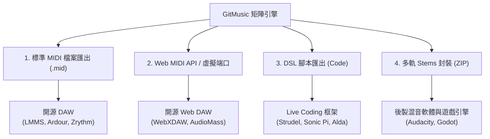

# 🎵 GitMusic 接入開源音樂製作項目之適配性與架構評估報告

> **文件版本**：v1.0  
> **建立日期**：2026-10-31  
> **核心主題**：評估 GitMusic 矩陣步進音序器（Step Sequencer）接入開源音樂製作生態（DAW、Live Coding、Web Audio）之可行性、架構瓶頸與技術實作路線圖。

---

## 一、 專案現況與架構定位

GitMusic 當前定位為**「Git 提交歷史 $\times$ 二維步進音序器 $\times$ 遊戲 BGM 生成器」**：
- **核心輸入**：專案 Git 提交歷史（透過本地 `git log --numstat` 解析為 Commits $\times$ Files 矩陣）。
- **音序核心**：橫軸為 Commit 步進點（Steps），縱軸為專案檔案軌道（Tracks），具備五聲音階防走音機制與雙向時長 / BPM 換算。
- **音訊架構**：基於 Tone.js 與原生 Web Audio API，實時調度合成器（Square Lead、Triangle Bass、Membrane Kick、Noise Snare、Metal Hi-Hat）。
- **當前輸出**：利用離線渲染（Offline Rendering）輸出 16-bit PCM `.wav` 及 128kbps `.mp3` 音訊檔。

---

## 二、 接入開源音樂專案之適配性評估

### 1. 核心優勢與契合點 (Advantages)
* **具備極高話題性的演算法音樂來源（Data Sonification）**：
  * 開源音樂社群（尤其是 Live Coding 與生成式音樂領域）高度青睞「具備客觀真實數據背書」的聲音生成源。將軟體工程版本控制歷史對應為音符，具備極強的 Meta 敘事與客製化色彩。
* **純 Web 前端技術棧（Zero Native Dependency）**：
  * 無需 C++ 或本機編譯環境，易於以 Web Component、npm 套件或 iframe 方式嵌入基於 Web / Electron 的開源音樂製作環境。
* **內建五聲音階調式保護**：
  * 相比傳統隨機數據映射產生的雜亂噪音，GitMusic 具備開箱即用的音樂調性保護，降低音樂門檻。

### 2. 當前關鍵瓶頸與缺陷 (Bottlenecks)
若直接嘗試與專業開源音樂工作站（DAW）或合成框架對接，現狀存在以下斷層：

| 評估維度 | GitMusic 現況 | 開源音樂製作專案標準需求 | 差距與影響分析 |
| :--- | :--- | :--- | :--- |
| **數據協議** | 僅能匯出靜態音訊檔（`.wav` / `.mp3`） | **標準 MIDI (`.mid`)**、MusicXML、OSC、Web MIDI API | **最關鍵缺口**。無法提供音軌資料（Note On/Off、Velocity、Duration），DAW 無法將其當作音序輸入。 |
| **音色引擎** | 內建固定 Web Audio 基礎波形合成器 | VST3 / CLAP / LV2 / SoundFont (SF2/SFZ) / WebAssembly 採樣器 | 音色表現偏向玩具級 8-bit，無法調用現代外掛或真實樂器庫。 |
| **曲式與節奏** | 扁平網格步進（1 Commit = 1 固定拍長 16n/8n/4n） | 拍號（Time Signatures）、小節（Bars）、多連音、延音線（Tie） | 缺乏複雜節奏與旋律延展性，音樂結構單一。 |
| **混音支援** | 單一混音立體聲輸出 | 分軌匯出（Stems Export：獨立 Kick/Bass/Lead 檔案） | 無法在第三方 DAW 進行獨立後製混音與母帶處理。 |

---

## 三、 開源音樂製作生態分類與對接策略

### 1. 開源 DAW（如 LMMS, Ardour, Zrythm）
* **契合程度**：★★★★☆（極高實用性，但需 MIDI 支援）
* **定位**：作為**「外部 MIDI 琶音 / 音序產生器」**。
* **接入方式**：
  * GitMusic 匯出多軌 `.mid` 檔案，使用者拖入 LMMS 或 Ardour，直接指派專業 SoundFont 或 VST 樂器進行編排。

### 2. Live Coding / 演算法音樂框架（如 Strudel, Sonic Pi, FoxDot）
* **契合程度**：★★★★★（技術與社群理念最契合）
* **定位**：作為**「代碼化節奏樣式（Pattern Generator）」**。
* **接入方式**：
  * 支援將網格矩陣一鍵轉換為 Strudel (TidalCycles JS) 語法或 Sonic Pi 程式碼，複製即可在 Live Coding 環境運行。

### 3. 開源 Web DAW 與 Web Audio 外掛（如 WebXDAW, Soundstage）
* **契合程度**：★★★☆☆（需封裝為模組）
* **定位**：作為 Web DAW 內的**「Git Sequencer 外掛模組」**。
* **接入方式**：
  * 將矩陣狀態管理與音序調度器抽離為獨立 npm 套件，透過標準 Web Audio AudioNode 或 Web MIDI 串接宿主。

---

## 四、 階段性升級實作路線圖 (Actionable Roadmap)

### Phase 1：協議開放（立即可行，高回報）
- [ ] **實作 Standard MIDI File (`.mid`) 匯出**：
  - 引入輕量 JavaScript MIDI 生成庫（如 `midi-writer-js`）。
  - 將專案內每一行檔案（Track）映射為獨立的 MIDI 軌道，包含標準 Note Number、Velocity、Duration 與 BPM 資訊。
- [ ] **實作分軌音訊（Stems）離線匯出**：
  - 擴充 `js/exporter.js`，支援將 Lead、Bass、Drums 個別獨立渲染並打包為 `.zip`。

### Phase 2：即時互動與腳本適配
- [ ] **Web MIDI API 實時輸出**：
  - 支援將當前播放頭（Playhead）觸發的 Note On/Off 實時發送至作業系統的虛擬 MIDI Port（如 loopMIDI），讓本機任何 DAW 實時監聽演奏。
- [ ] **Live Coding DSL 匯出器**：
  - 提供一鍵產生 Strudel、Sonic Pi 演奏代碼功能。

### Phase 3：模組化解耦（SOLID 重構）
- [ ] **核心音序邏輯解耦**：
  - 將 Git 解析器、音階轉換器與步進排程器從 DOM 渲染（`ui.js`）完全抽離，封裝為無介面（Headless）核心函式庫，方便第三方開源專案引入。
